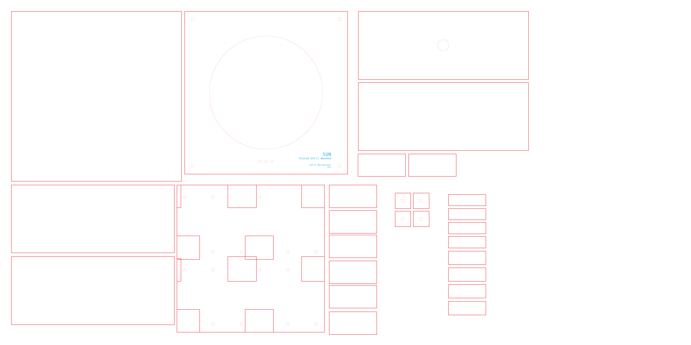
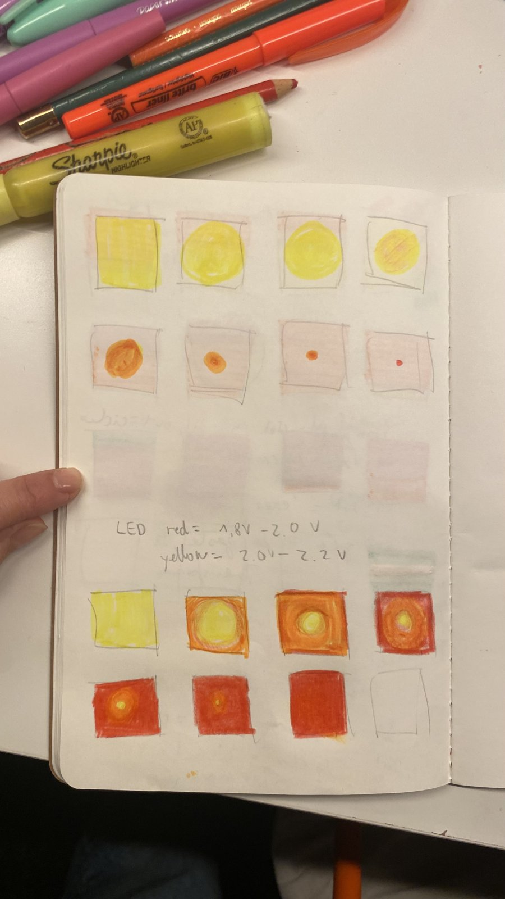
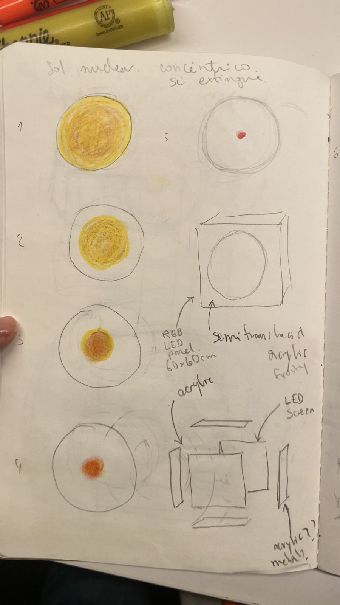
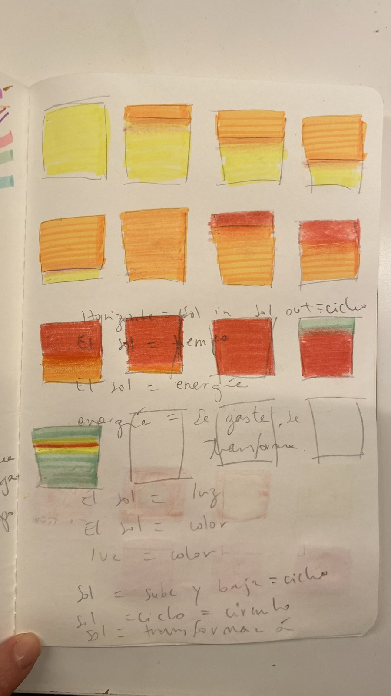
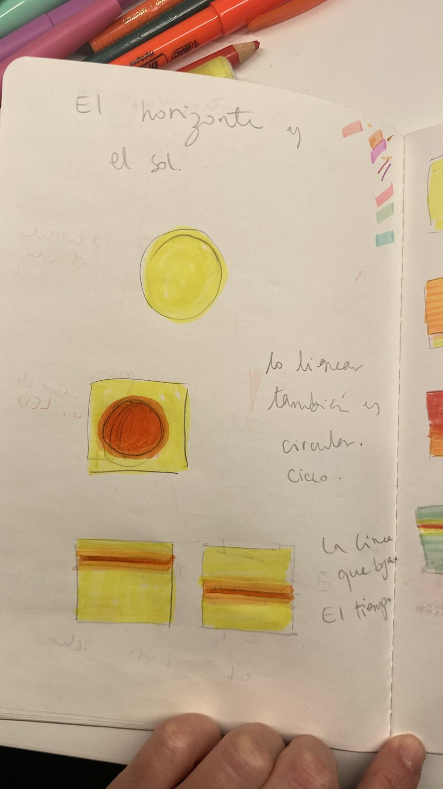
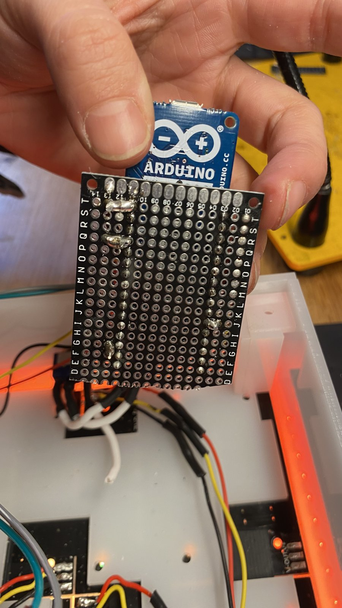

# SUN · Stored Until Needed

**Sofía Bernasconi, 2026**
Solar-powered light installation · 16×16 LED matrix · Arduino

---

## About the work

**SUN** is a solar-powered light installation that simulates the emergence and transformation of a sun through a 16×16 LED matrix. The piece begins with a point of light that gradually intensifies and expands, forming a full luminous body before transitioning into an inverted color state.

Powered by a solar panel and battery system, the work stores energy during the day and releases it when needed, embodying a cycle of accumulation and activation.

Developed for the course *Energy* (Prof. Jeff Feddersen) at ITP, Tisch School of the Arts, New York University.

More about my work: [sofiabernasconi.com](https://sofiabernasconi.com)

---

## How it works

```
6V solar panel ──► battery pack (5V) ──► Arduino MKR1000 ──► 16×16 LED matrix
   (harvests)          (stores)            (animation)        (4 × 8×8 WS2812B)
```

The solar panel charges a battery pack during the day. The battery powers the Arduino and the LED matrix, which plays the sun animation: a circle of light whose color shifts slowly between yellow and red, while the background shifts the opposite way.

---

## Repository structure

```
arduino/
  sun/sun.ino                                   Final code used in the piece
  experiments/
    sun_distance_sensor/sun_distance_sensor.ino Version with a distance sensor (tested, not used)
  tests/
    sun_basic/sun_basic.ino                     First version of the animation
fabrication/
  enclosure-laser-cut.ai                        Laser-cut file for the enclosure
docs/
  enclosure-laser-cut.png                       Preview of the laser-cut file
  process/                                      Sketches and build photos
```

---

## Hardware

| Part | Notes |
|---|---|
| LED matrix | 4 × WS2812B 8×8 panels (256 LEDs), arranged as a 16×16 square |
| Microcontroller | [Arduino MKR1000](https://docs.arduino.cc/hardware/mkr-1000-wifi/). Any Arduino-compatible board works. |
| Battery | Voltaic battery pack, 5V output |
| Solar panel | 6V |
| Power breakout | CP2104 USB-to-serial board, used to take VCC and GND from the battery's USB output |
| Enclosure | Laser-cut acrylic, file in `fabrication/` |
| Distance sensor (experiment only) | VL53L0X time-of-flight sensor, I2C |

### Wiring

| From | To |
|---|---|
| Arduino pin **2** | LED matrix DIN (data in) |
| Battery 5V | LED matrix 5V and Arduino VIN |
| Battery GND | LED matrix GND and Arduino GND |

For the sensor experiment, the VL53L0X connects to the Arduino I2C pins (SDA, SCL), plus power and GND.

### Panel layout

The four 8×8 panels are chained in a 2×2 grid. The `XY()` function in the code maps each (x, y) coordinate of the 16×16 image to the right LED:

```
┌─────────┬─────────┐
│ panel 0 │ panel 1 │
├─────────┼─────────┤
│ panel 2 │ panel 3 │
└─────────┴─────────┘
```

Inside each panel the LEDs run row by row, left to right. If your panels are wired in a different order, adjust `XY()`.

---

## Running the code

1. Install the [FastLED](https://github.com/FastLED/FastLED) library from the Arduino Library Manager. For the sensor experiment, also install **Adafruit_VL53L0X**.
2. Open `arduino/sun/sun.ino` in the Arduino IDE.
3. Select your board and port, and upload.

Adjustable values in `sun.ino`:
- **Colors:** the palette at the top of the sketch (`COLOR_YELLOW`, `COLOR_RED`, `COLOR_ORANGE`) and which colors the circle and background use (`CIRCLE_COLOR_A/B`, `BG_COLOR_A/B`).
- `BRIGHTNESS`: overall brightness (0–255). A lower value saves battery.
- `r`: radius of the sun. `edge`: width of its soft edge.
- The `0.0005` value in the line marked `// speed`: how fast the colors shift.

### The distance sensor experiment

`sun_distance_sensor.ino` makes the sun emerge from the center when someone approaches: it grows and brightens as the person gets closer, and the background appears once the sun is almost fully formed. The sensor range is set with `DISTANCE_FAR_MM` (600 mm, off) and `DISTANCE_NEAR_MM` (120 mm, fully on).

I did not use this version in the final piece because I did not like how the sensor looked in the enclosure design. Integrating it is one of the next steps.

---

## Solar panel measurements

| Condition | Voltage | Current |
|---|---|---|
| Under artificial light | 7.2 V | 0.9 A |
| Inside a normally lit room | 4.6 V | 0.4 A |

---

## Fabrication



The enclosure is laser cut from acrylic. The front panel has a circular opening for the sun. The `.ai` file also opens as a PDF.

---

## Process

The animation started as drawings: color studies, a concentric sun that grows and fades, and the sun meeting a horizon line. I then designed the animation in p5.js before moving it to the LED matrix.

| | | |
|---|---|---|
|  |  |  |
|  |  | |

---

## Next steps

- Use a smaller battery.
- Use a smaller microcontroller, such as an ATtiny.
- Integrate the distance sensor, or modify the enclosure design so it can be integrated.

---

## License

The code in this repository is released under the [MIT License](LICENSE).

The artwork, images, drawings and fabrication files of *SUN* are © Sofía Bernasconi, all rights reserved.
